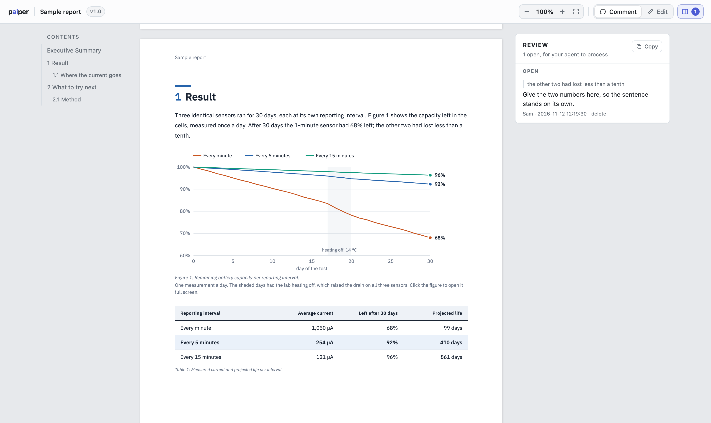
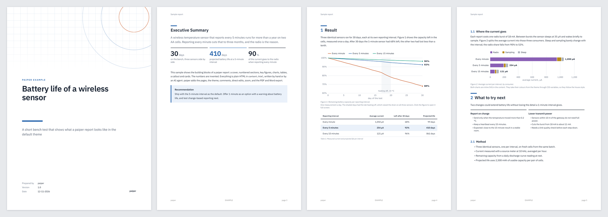

# p**ai**per

**Review what your AI agent writes, on real pages, and send your comments straight back to it.**

paiper is a browser-based tool for documents written by AI agents. It runs on your own machine. The agent writes a report as HTML, so it can use everything the web can draw: charts built from your data, diagrams, illustrations, precise layout. paiper shows the result as pages in your browser, where you comment on any paragraph or fix the wording yourself. Your comments go back to the agent as a work list, and every one gets a reply when it is handled. The same document exports to PDF and Word.



## How it works

1. **The agent writes.** A document is a folder with one HTML file. Agents are fluent in HTML, SVG and CSS, so a chart or an illustration costs them no more effort than a paragraph.
2. **You review.** Open the page, click a paragraph, type a comment. Or switch to Edit and change the text in place.
3. **The agent processes.** It reads the open items, makes the changes, and answers each one. The answers show up next to your comments.

Nothing gets lost between rounds. A comment stays attached to its paragraph. When a script generates the document, an edit you make in the browser blocks the next build until the agent has carried it into that script.

It works with Claude Code, the Claude desktop app, Codex, Cursor, Gemini CLI, and anything else that can run a shell command or speak MCP.

## What the documents look like

The sample in `examples/`, as PDF:



## Where it came from: a field test report

paiper grew out of one report. A machine had run for several days at a customer site, and the material was large and scattered: per-item log files, throughput data, camera stills and video clips, notes from the days on site, earlier documents about the product, and the machine's own codebase.

An agent read all of it and built one report: 47 pages, with charts drawn from the logs, annotated photos, and tables whose numbers a build script checks against the data on every run.

The review is what made it usable. The author read the report at his own pace and left 140 comments over three rounds, each one on the paragraph, chart or photo it was about: split a chart differently, question a number, swap a photo, rewrite a conclusion. There was no copying text into a chat and no explaining where something was. The agent worked through each batch, changed the script and the data analysis behind it, and answered every comment in the margin.

What that takes, and what paiper provides:

- **From a lot of context to one document.** The agent does the reading and the analysis. The report is where you check it.
- **Review in batches.** Comment on everything you notice, then hand over the whole list. The agent does not need you while it works, and you do not need the agent while you read.
- **Graphics without a ceiling.** Charts, diagrams and photo layouts are web graphics, so the agent can redraw any of them when a comment asks for it.
- **Numbers that stay right.** A generated document is rebuilt from the data, so a corrected analysis updates every figure that depends on it.

## What you get

- **The whole web toolbox.** A document is free HTML: inline SVG charts and diagrams, CSS layout, scripts, video. paiper does not limit the agent to a set of components, and a word processor's drawing tools are not the ceiling.
- **Real pages.** A4 or US Letter, on screen as in the PDF: cover, contents, numbered figures and tables, header and footer. Setup picks Letter in North America and A4 elsewhere; `"page": "letter"` in a document's `paiper.json` overrides it.
- **Your house style.** The built-in theme looks good as it is. Your company's fonts, colours, logo and cover go in a theme folder that you keep private.
- **PDF and Word.** Both come from the same HTML.
- **Local and small.** One server on your own machine, Python standard library only, no account. paiper sends nothing anywhere.
- **Run by the agent.** It installs paiper, writes the documents, and runs every command. You only read and review.

## Who it is for

One person working with their agent on reports, studies and write-ups that live in a folder: a git repo, a notes vault, a project directory. It does not replace Google Docs or SharePoint for teams editing together.

## Install

Let your agent do it. Tell it:

> Install paiper from github.com/stefanvanderheijden/paiper. My documents are in ~/Documents/projects.

It reads [AGENTS.md](AGENTS.md) and runs:

```sh
git clone https://github.com/stefanvanderheijden/paiper ~/code/paiper
~/code/paiper/bin/paiper setup --root docs=~/Documents/projects --author "Your Name"
~/code/paiper/bin/paiper doctor
```

Requirements: macOS or Linux, Python 3.9+, git. The repo is about 2 MB and has no dependencies.

`setup` puts `paiper` on your PATH, writes a config file, keeps the server running at login, and registers paiper with the agents it finds (one entry named `paiper`; the rest of their config is left alone). It can be run again at any time, and `--no-agents` or `--no-service` skip those parts. Then open <http://localhost:8760/>; the sample report is listed straight away.

PDF export and a full-quality Word export use tools that may not be on your machine. `setup` and `doctor` name the missing ones and print one command that installs them (Homebrew, apt, dnf, pacman, zypper). The agent runs it.

| | |
|---|---|
| PDF export | needs WeasyPrint |
| Word export | built in; `rsvg-convert` (librsvg) draws the charts, LibreOffice and `pdfinfo` (poppler) fill in contents page numbers |
| Update | `paiper update` (git pull, restart the server) |
| Remove | `paiper uninstall` removes the service, the launcher and the agent entries. Your documents and config stay. |

## A document

```
my-report/
  paiper.json      title, theme, cover, metadata; "build" if a script generates the content
  content.html     <section>s with <h1 id>/<h2 id>, paragraphs, tables, figures, any SVG
  build.py         optional: writes content.html from data
  comments.json    review items, written by the server
  img/ ...         anything the content references
```

```json
{
  "type": "report",
  "title": "Sorter study",
  "theme": "default",
  "content": "content.html",
  "cover": {"kicker": "Research", "title": "Sorter study", "subtitle": "What we measured and what it means"},
  "meta": [["Version", "1.0"], ["Date", "12-11-2026"]]
}
```

## Commands

The person never needs these; the agent runs them.

```
paiper new <folder> --title T [--theme NAME]   start a document
paiper url <folder>                            its address on the local server
paiper review <folder> [--json]                open comments and edits
paiper reply <folder> <id> "what changed"      answer an item and mark it processed
paiper build <folder>                          run a generated document's build script
paiper pdf <folder>                            PDF (A4 or Letter)
paiper docx <folder> [out.docx]                native Word document
paiper export <folder> <dir>                   self-contained static copy
paiper list | themes | config ...               documents, themes, settings
paiper setup | doctor | update | uninstall     install, check, update, remove
paiper serve | service ... | mcp               the server, the login service, the MCP server
```

## Themes

A theme is a folder with `theme.json` (font, logo, organisation, footer, palette, `"tables": "ruled"` for lined instead of filled tables), `theme.css` (CSS variables such as `--font`, `--ink`, `--accent`, `--light`, the chart series `--s1` to `--s5`, plus the cover layout) and `cover.html`. Built-in themes live in `paiper/themes/`; point `paiper setup --theme-path <dir>` at a folder of private ones. The reading interface around the pages is paiper's own and is never themed.

The Word export (`paiper docx`) builds a native .docx from the same content and theme, with the Python standard library only: built-in Word styles (Title, Heading 1-3, Caption, List Paragraph, TOC) in the theme's font and colours, real lists and tables, embedded photos, inline SVG converted to PNG (`rsvg-convert`), the theme's cover, a contents field and the theme's header and footer. A theme can name the Word font and the TrueType files to embed in `theme.json`: `"docx": {"font": "Satoshi", "embed": ["fonts/Satoshi-Regular.ttf", ...]}`. When LibreOffice is installed, the contents page gets its page numbers from a LibreOffice layout pass (`--fast` skips it).

## Under the hood

- `paiper/doc.py` renders a document: the content, the theme's cover, a contents page, comment anchors on every block (derived from the block text, or kept when a build script sets them), and the page CSS for print.
- `paiper/runtime/viewer.js` lays the content out as A4 sheets in the browser and handles zoom and the lightbox; `review.js` is the comment and edit layer.
- `paiper/server.py` serves every document under the configured roots and a small JSON API for review items and edits. The content is re-rendered on every request, so an agent's change is visible on reload.
- `paiper/mcp.py` is a dependency-free MCP server over stdio.
- `paiper/docx.py` is the Word export. It is the largest file and nothing else depends on it.

The core (renderer, server, review store, CLI, MCP) is about 1,700 lines of Python and 450 lines of JavaScript.

## Security

The server is for your own machine and has no login, because it never listens on the network.

- It binds to 127.0.0.1 and answers only requests addressed to `localhost` (against DNS rebinding).
- It accepts writes only as JSON from a localhost origin, so a website you visit cannot write to your documents.
- It serves files only from inside document folders, and never `comments.json`, `paiper.json` or hidden files.
- A Content-Security-Policy stops documents from loading code from, or sending data to, another machine. Documents that need internet resources: `paiper config --remote-content on`.
- Edits made in the browser are reduced to inline formatting before they are written.

Two things to know: documents are trusted HTML (a script in one document can read your other documents), and `paiper build` runs the build command a document names. Only keep documents you or your agent wrote under a configured root. Details in [SECURITY.md](SECURITY.md).

## Status

Early (0.2). Used daily for engineering reports. macOS and Linux; Windows is untested. Next: decks (16:9 with presenter view), print handouts, Markdown content.

## License

MIT
